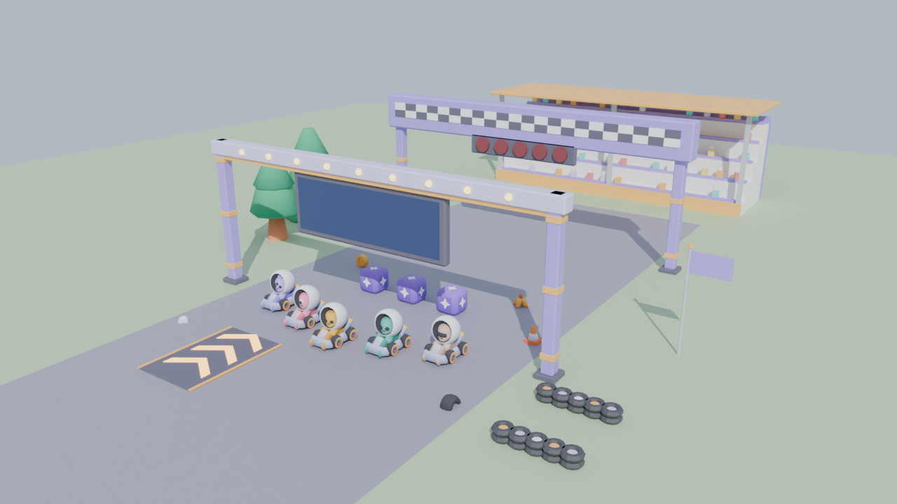

# Quiz Kart Rally

**The right answer is the fastest line.** A kart racer for the [EdVerse](https://workspace.mexty.ai/edverse/studio) kids' store, in the spirit of Turbo Gates.
Before each row of item boxes a question appears on the gantry, and every box carries one answer. Drive through the right box to win a random bonus. Drive through a wrong one and your kart spins out.


## Gameplay

| Question ahead | Race results |
| --- | --- |
|  |  |


- **Answer rows:** each lap passes 3 rows of 2 to 4 boxes. The lane you drive through is your answer.
  - The question shows on the gantry screen and on a HUD card with the answers in lane order and colour.
  - Rows draw from a shuffled bank of 12 questions per cup, so a 3-lap race asks 9 different questions.
- **Right answer:** a bonus roulette spins and lands on one of six bonuses. Racers further back get better bonuses.
  - **Turbo:** one burst of speed.
  - **Triple turbo:** three bursts.
  - **Bubble shield:** absorbs one spin-out.
  - **Banana peel:** dropped behind you for rivals to spin on.
  - **Coin bag:** five coins.
  - **Super nova:** a few seconds of speed that knocks rivals aside.
- **Wrong answer:** the kart spins out and loses 2 coins, and the right answer and its explanation flash on screen. The shield absorbs it.
- **Race:** the player plus 4 rivals over 3 laps.
  - The rivals answer too, with their own accuracy, so they get bonuses and spin-outs like the player.
  - A soft rubber band keeps the pack close.
- **Driving:**
  - The kart accelerates by itself; the player steers and brakes.
  - Coins add top speed (up to 10).
  - Boost pads on the road.
  - Drift with mini-turbos: blue after a short drift, orange after a long one.
- **4 cups** (finishing one unlocks the next), each with its own circuit and light:
  - Sunny Sums: adding and taking away to 100, by day.
  - Times-Table Trail: times tables up to 12, in the morning, with hills.
  - Division Dunes: division, at sunset.
  - Mixed Moonlight: order of operations, at night.
- **Results:** position, time, right answers, standings, and the log of every question with the right answer next to each mistake.
- **Controls:**
  - **Keyboard:** arrows, WASD or ZQSD; Shift to drift; Space or E for the bonus; Esc to pause.
  - **Phone:** buttons for left, right, brake and drift; tap the bonus box to use it.
  - **Gamepad:** supported.
- **Sound:** music and sound effects are synthesised in code with WebAudio, so there are no audio files.
- **EdVerse SDK:**
  - Cloud saves (unlocked cups, best place and time per cup, chosen racer).
  - Learning progress for every answer.
  - A family leaderboard per cup.
  - Pause and mute from the store.
  - English and French.
- **Content:** every text, question, circuit, racer and model URL is a prop, so a new variant can race on any topic.

<br clear="right">

## Repository layout

| Path | What it is |
| --- | --- |
| `vendor/kenney/` | The Kenney Car Kit and Toy Car Kit models the game uses (CC0, licences included). |
| `blender/` | Headless Blender scripts. `pack_kenney.py` packs the Kenney models into self-contained GLBs at game scale. `make_props.py` builds the track furniture procedurally: question gantry, start arch with countdown lamps, boost pad, tyre wall, grandstand and flag. `preview.py` renders the kit sheet. |
| `game/` | The EdVerse block source: React and three.js. `src/block.tsx` holds the `BlockProps` schema and the screen flow; `src/game/` holds the engine (track, kart physics, rival AI, world builder, bonuses, effects, audio, HUD). |
| `game/public/models/` | The exported `.glb` models used for local development. |
| `tools/` | `tracks.json` (the circuits), `check-tracks.mjs` (checks corner radius and clearance, and suggests where rows go), `make-props.py` (builds the default content), `shots.py` (README screenshots) and `control-test.py` (a headless driving test). |
| `content/` | `props.json` is the default content (EN and FR) with local model paths. `props.edverse.json` is the same content with the CDN model URLs used on EdVerse; `asset-urls.json` maps each model to its upload. |
| `docs/` | The screenshots on this page and the kit preview. |



## Rebuild the models

```bash
python3 blender/pack_kenney.py -- vendor/kenney blender/out
python3 blender/make_props.py -- blender/out
python3 blender/preview.py -- blender/out docs/kit-preview.png
cp blender/out/*.glb game/public/models/
```

The scripts run with the `bpy` module or inside Blender (`blender --background --factory-startup --python <script> -- <args>`).

## Edit the content

```bash
node tools/check-tracks.mjs tools/tracks.json   # after changing a circuit
python3 tools/make-props.py                      # rebuilds content/*.json and game/src/dev-props.json
```

## Run locally

```bash
cd game && npm install && npm run dev
```

The game opens on http://localhost:5299 using `src/dev-props.json`.

- Type-check with `npx tsc --noEmit`.
- Add `?qkdebug` to the URL to expose the engine as `window.__qk`. `advance(seconds)` simulates without rendering.
- With the dev server running, `python3 tools/shots.py docs/screenshots title cups racer race answer mobile results` regenerates the screenshots, and `python3 tools/control-test.py` checks steering, drift, mini-turbo, bonus, pause and the barrier.

On EdVerse, `src/App.tsx`, `src/index.tsx`, `webpack.config.js` and `AI.md` come from the platform scaffold. Only `src/block.tsx`, `src/game/` and `package.json` are pushed there. `src/dev-props.json`, `src/dev-shots.ts` and `src/styles.css` are for local development only.

## Credits

- Karts, drivers, item boxes, coins, banana peel, trees and cones: [Kenney](https://kenney.nl) Car Kit and Toy Car Kit, CC0.
- Track furniture, circuits, code, music and sound: made for this game.
