# Quiz Kart Rally

**The right answer is the fastest line.** A 3D kart racer for the [EdVerse](https://workspace.mexty.ai/edverse/studio) kids' store, in the spirit of Turbo Gates.
Before each row of item boxes a question appears on the gantry, and every box carries one answer. Drive through the right box to win a random bonus. Drive through a wrong one and your kart spins out.
Race alone against four rivals, or online against up to seven friends.

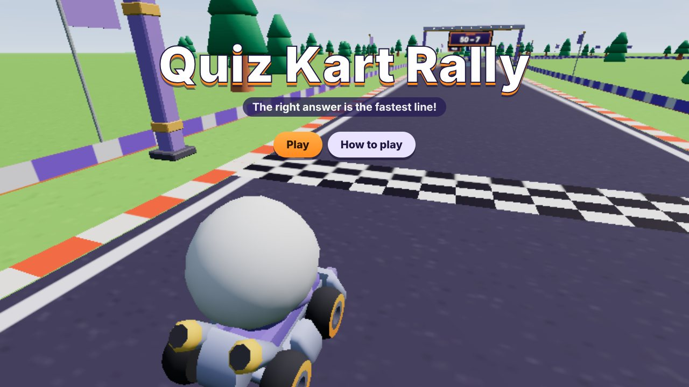

## Gameplay

| Question ahead | Night circuit |
| --- | --- |
| 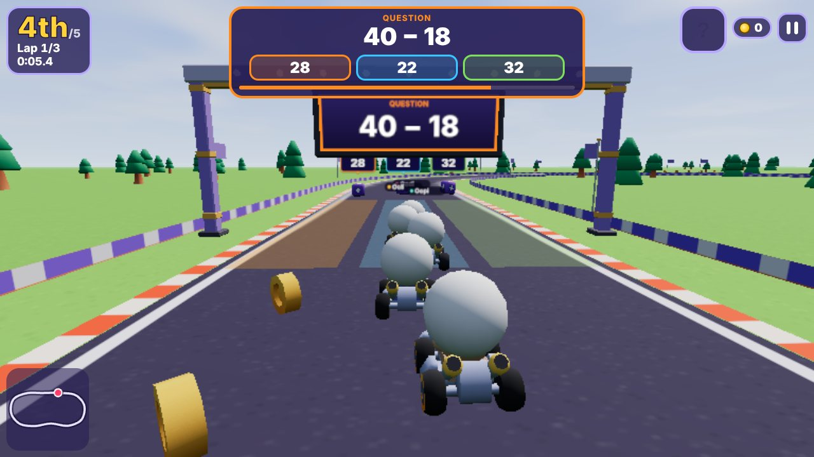 | 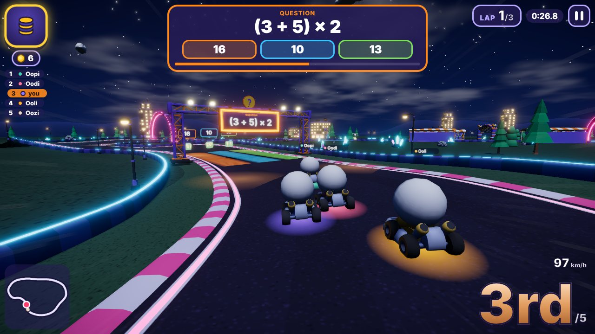 |
| **Jumps and tricks** | **Podium and results** |
| 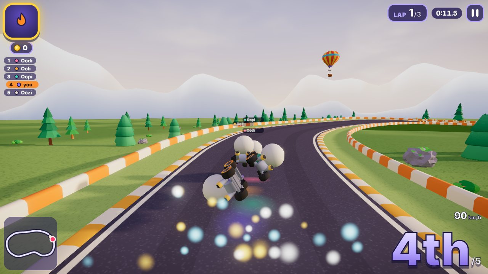 | 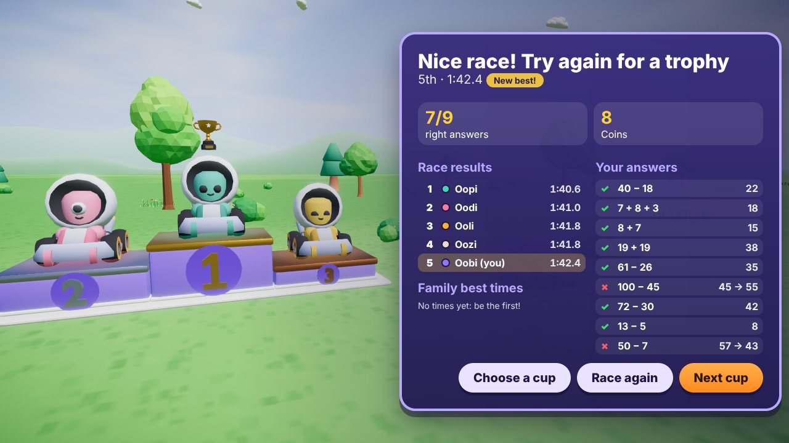 |

- **Answer rows:** each lap passes 3 rows of 2 to 4 boxes. The lane you drive through is your answer.
  - The question shows on the gantry screen and on a HUD card with the answers in lane order and colour.
  - Rows draw from a shuffled bank of 12 questions per cup, so a 3-lap race asks 9 different questions.
- **Right answer:** a bonus roulette spins and lands on one of six bonuses. Racers further back get better bonuses.
  - **Turbo:** one burst of speed.
  - **Triple turbo:** three bursts.
  - **Bubble shield:** absorbs one spin-out.
  - **Banana peel:** dropped behind you for rivals to spin on.
  - **Coin bag:** five coins.
  - **Super nova:** a few seconds of speed that knocks rivals aside.
- **Wrong answer:** the kart spins out and loses 2 coins, and the right answer and its explanation flash on screen. The shield absorbs it.
- **Driving:**
  - Hold the gas to drive, steer and brake. Press the gas during the last count of the countdown for a rocket start.
  - Coins add top speed (up to 10).
  - Boost pads on the road.
  - Drift with mini-turbos: blue sparks after a short drift, orange after a long one.
  - Two jump ramps per circuit. Tap drift in the air for a trick and a boost on landing.
  - Banked corners, skid marks, speed lines and a chase camera that leans into drifts.
- **4 cups** (finishing one unlocks the next), each with its own circuit, scenery and song:
  - Sunny Sums: adding and taking away to 100, in a meadow with windmills and a barn.
  - Times-Table Trail: times tables up to 12, among pine hills in the morning.
  - Division Dunes: division, in a sunset desert with mesas, palms and a rock arch.
  - Mixed Moonlight: order of operations, through a neon city at night.
- **Race flow:** an intro fly-over, the countdown on the start arch's lamps, then 3 laps. The final lap speeds up the music. The top three finish on a podium with a trophy and fireworks.
- **Results:** position, time, right answers, standings, and the log of every question with the right answer next to each mistake.
- **Controls:**
  - **Keyboard:** ↑ (or W / Z) to accelerate, ← → to steer, ↓ to brake (arrows, WASD or ZQSD); Shift to drift; Space or E for the bonus; Esc to pause.
  - **Phone:** left and right on the left; brake, drift and a big orange gas pedal on the right (drift keeps accelerating); tap the bonus box to use it.
  - **Gamepad:** stick to steer, A or right trigger to accelerate, B or left trigger to brake, bumpers to drift, X or Y for the bonus.
- **Sound:** four songs and every sound effect are synthesised in code with WebAudio, so there are no audio files.

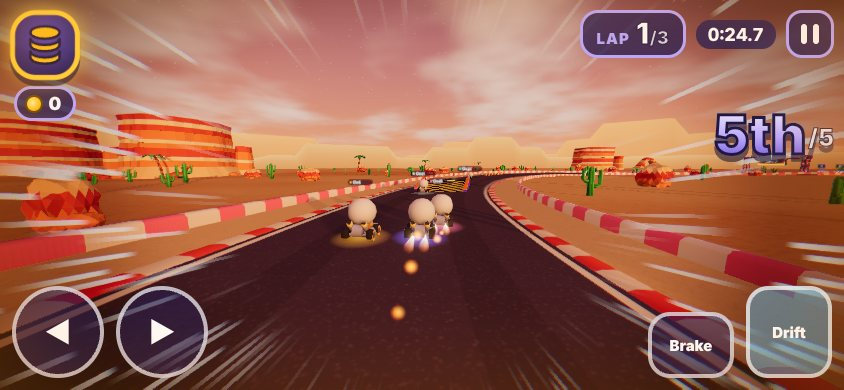

## Graphics

- **Quality levels:** the game reads the GPU and picks Low, Medium, High or Ultra. The player can change it in the pause menu.
- **Post-processing** (Medium and up): bloom, SMAA or FXAA, ACES tone mapping, vignette, speed lines, and colour fringing while boosting.
- **Frame-rate guard:** the render resolution drops a step when frames run slow and comes back when they recover.
- **Scenery:** instanced trees, rocks and flowers that sway in the wind, water with moving waves, layered hills, drifting clouds, hot air balloons, cheering grandstands, and lamps whose pools of light glow at night.
- **Karts:** boost flames, a shimmering bubble shield, a rainbow glow during super nova, soft shadows and squash on landing.

<br clear="right">

## Online races

| Race online | Join with a code | Lobby with QR code |
| --- | --- | --- |
| 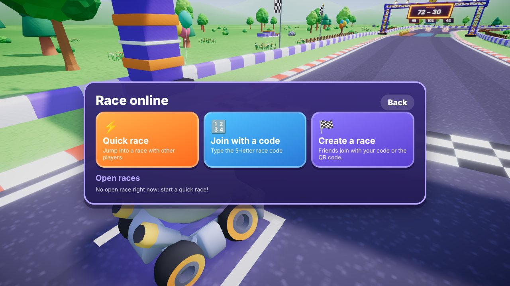 | 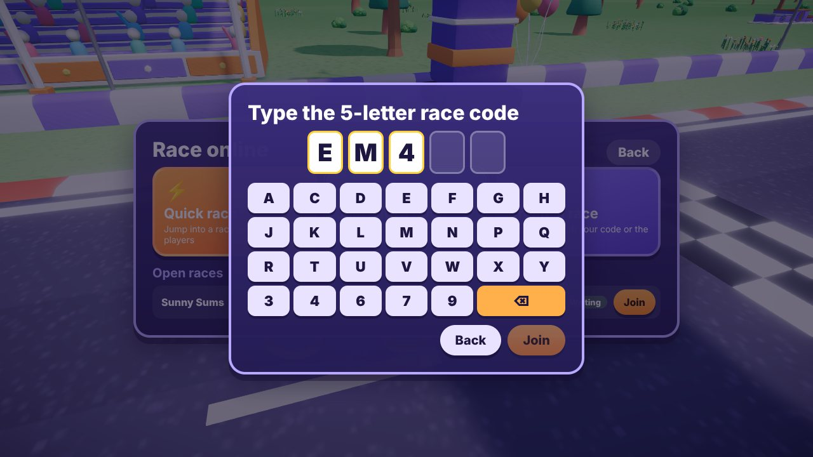 | 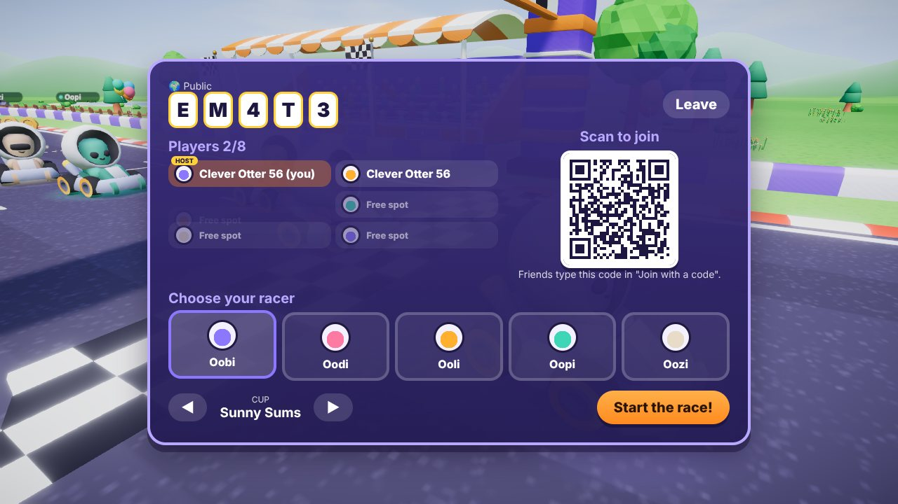 |

- **Quick race:** joins the fullest open quick race, or opens a new one. A quick race starts by itself 20 seconds after it opens, and the timer gives a little more time when someone joins.
- **Join with a code:** every race has a 5-letter code. The code uses only letters and digits that are hard to confuse (no O and 0, no I and 1).
- **QR code:** the lobby shows a QR code that opens the game straight into that race. A link with `?join=CODE` does the same.
- **Open races:** public races are listed in the menu with their cup and number of players. Tap Join to enter.
- **Create a race:** choose public or private and the cup. A private race can only be joined with its code or QR code.
- **Lobby:**
  - Up to 8 players. Each picks a racer.
  - The host picks the cup and starts the race.
  - Free places on the 6-kart grid are filled with AI rivals.
- **Late joiners** watch the race in progress and race in the next one.

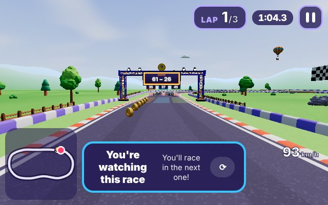

- **During the race:** every player drives their own kart and answers their own questions. Everyone gets the same questions in the same order.
- **After the race:** the results are the same on every screen, then everyone goes back to the lobby for the next race.
- **Leaving:** if the host leaves, the next player takes over the lobby and the AI karts, even mid-race.
- **Names:** players appear under a generated nickname (such as "Clever Otter 56"). The game never shows an account name.

### How it works

- **Messages** go through Mexty's LiveKit server as data packets (`src/net/transport.ts`). Kart positions go 15 times a second as lossy packets; everything else is reliable.
- **Lobby** (`src/net/lobby.ts`):
  - The first player to join is the host and holds the lobby state: members, cup, phase, start time and results.
  - Clocks are synchronised by ping, so every screen starts the countdown at the same moment.
  - Remote karts are drawn 110 ms in the past and interpolated between updates.
- **Open races** are stored with the EdVerse SDK as shared rows in the `lobbies` collection, one row per host, refreshed every 10 seconds; rows older than 30 seconds are ignored. A directory room also announces them live. The `lobbies` collection must be declared in the Studio (game → Data).
- **Room tokens** come from the Mexty API with the play token the EdVerse player gives the game. Outside EdVerse, the online menu says online races are unavailable.

## Repository layout

| Path | What it is |
| --- | --- |
| `vendor/kenney/` | The Kenney Car Kit and Toy Car Kit models used for the karts, drivers, coins and peels (CC0, licences included). |
| `blender/` | Headless Blender scripts, all procedural (no generated or downloaded models). `make_kit2_*.py` build kit 2 (track kit and the four themes, described in `KIT2.md`); `validate_kit2.py` checks it; `preview2.py` renders the previews. `pack_kenney.py`, `make_props.py` and `preview.py` build the first kit. |
| `game/` | The EdVerse block source: React and three.js. `src/block.tsx` holds the `BlockProps` schema and the screen flow. `src/game/` holds the engine: track, kart physics, AI, world builder, themes, renderer, camera, kart effects, particles, skid marks, audio, HUD and menus. `src/net/` holds the online transport and lobby. |
| `game/public/models/` | The exported `.glb` models used for local development. |
| `tools/` | `tracks.json` (the circuits), `check-tracks.mjs` (checks corners and clearance, and suggests where rows and jumps go), `make-props.py` (builds the default content), `shots.py` (screenshots), `control-test.py` (a driving test), `mp-test.py` and `mp-test2.py` (online tests), `lk-token.mjs` (tokens for a local LiveKit server). |
| `content/` | `props.json` is the default content (EN and FR) with local model paths. `props.edverse.json` is the same content with the CDN model URLs used on EdVerse; `asset-urls.json` maps each model to its upload. |
| `docs/` | The screenshots on this page and the kit previews. |

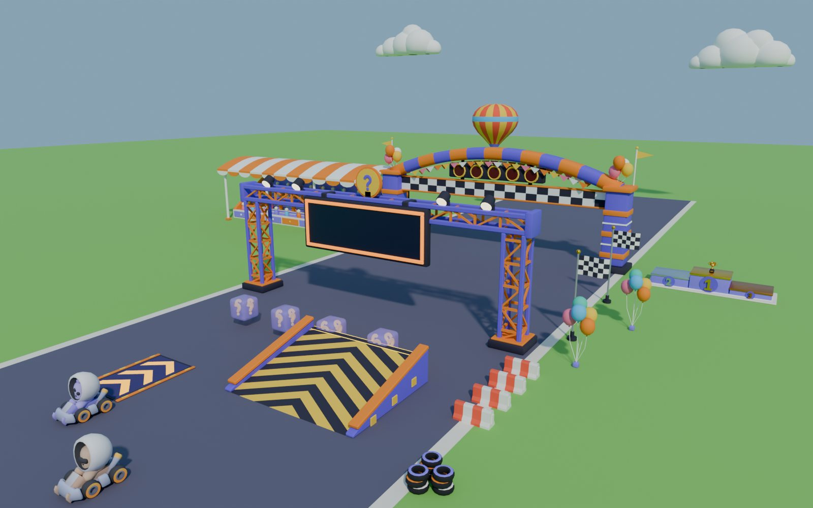

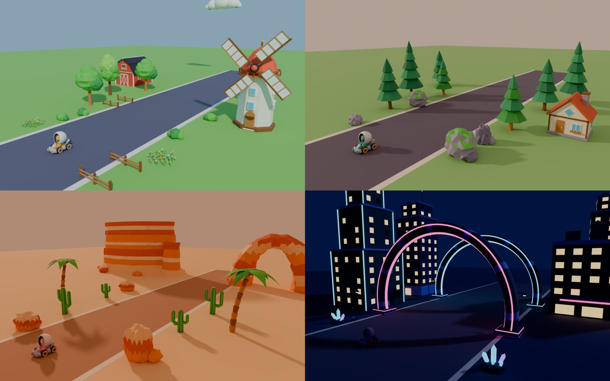

## Rebuild the models

```bash
for k in track meadow hills desert night; do python3 blender/make_kit2_$k.py -- blender/out2; done
python3 blender/validate_kit2.py blender/out2
cp blender/out2/*.glb game/public/models/
```

The scripts run with the `bpy` module or inside Blender (`blender --background --factory-startup --python <script> -- <args>`). The karts come from `blender/pack_kenney.py` (see the first kit's commands in the script headers).

## Edit the content

```bash
node tools/check-tracks.mjs tools/tracks.json   # after changing a circuit
python3 tools/make-props.py                      # rebuilds content/*.json and game/src/dev-props.json
```

## Run locally

```bash
cd game && npm install && npm run dev
```

The game opens on http://localhost:5299 using `src/dev-props.json`.

- Type-check with `npx tsc --noEmit`; `npm run build` makes the production (webpack) bundle.
- Add `?qkdebug` to the URL to expose the engine as `window.__qk` and unlock every cup. `advance(seconds)` simulates without rendering.
- Set `qk-tier` in local storage (`low`, `medium`, `high` or `ultra`) to force a quality level, as the pause menu does.
- With the dev server running, `TIER=high CUP=0 python3 tools/shots.py docs/screenshots title answer results` regenerates screenshots, and `python3 tools/control-test.py` checks steering, drift, mini-turbo, bonus, pause and the barrier.

### Online races locally

- `?net=local` connects browser tabs of the same browser through a BroadcastChannel, with no server.
- `?net=lkdev` uses a local LiveKit server:

```bash
livekit-server --dev --bind 127.0.0.1 --node-ip 127.0.0.1   # keys devkey / secret
node tools/lk-token.mjs                                      # tokens on :7890
python3 tools/mp-test.py out/mp                              # 3 browsers: create, join by code, join from the list, race, host leaves
python3 tools/mp-test2.py out/mp2                            # quick race, a late joiner watches then races
```

## Deploy to EdVerse

On EdVerse, `src/App.tsx`, `src/index.tsx`, `webpack.config.js` and `AI.md` come from the platform scaffold. Only `package.json`, `src/block.tsx`, `src/game/` and `src/net/` are pushed there. `src/dev-props.json`, `src/dev-shots.ts` and `src/styles.css` are for local development only. The saved props variant is `content/props.edverse.json`.

## Credits

- Karts, drivers, item boxes (kit 1), coins and banana peel: [Kenney](https://kenney.nl) Car Kit and Toy Car Kit, CC0.
- Kit 2 models, circuits, code, music and sound: made for this game.
